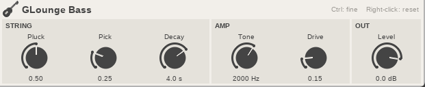
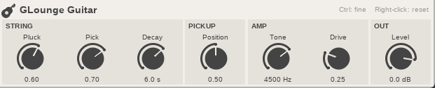

# GLounge

A small band of instruments for [REAPER](https://www.reaper.fm/), made for low-spec PCs. No samples to download: each sound is calculated live, in one small text file.

## The band

| Instrument | Status |
|---|---|
| **Bass** | Ready |
| **Electric guitar** | Ready |
| Drums | Planned |
| 8-bit | Planned: a retro video game chip sound |
| Piano | Planned: a soft, felt-style piano rather than a concert grand |

## Install

| System | Download | Then |
|---|---|---|
| **Windows** | [GLounge-Windows.zip](https://github.com/absentlo/GLounge/releases/latest/download/GLounge-Windows.zip) | Unzip it and double-click `install.bat` |
| **Linux** | [GLounge-Linux.tar.gz](https://github.com/absentlo/GLounge/releases/latest/download/GLounge-Linux.tar.gz) | Extract it and run `./install.sh` |

Restart REAPER after installing.

On a portable REAPER, pass its folder to the installer, or copy the `.jsfx` and `.jsfx-inc` files into its `Effects` folder.

## Play

1. On a track, open the FX window, click **Add** and search for `GLounge`.
2. Arm the track and turn on monitoring.
3. Open **View > Virtual MIDI Keyboard** and play low notes. The bass's open E is E1, MIDI note 28.

## Controls

- **Drag up or down:** turn a knob.
- **Ctrl + drag:** turn it slowly.
- **Right-click:** reset a knob.
- **+ next to the preset list:** save a sound.

## Bass

| Knob | What it does |
|---|---|
| **Pluck** | How sharp the attack is. Velocity adds to it, so playing harder sounds brighter. |
| **Pick** | Fingers at 0, a pick at 1. |
| **Decay** | How long a held note rings. |
| **Tone** | Lower is darker. |
| **Drive** | From clean to a dirty amp. |
| **Level** | Output volume. |

The bass plays one note at a time, like a single string under your hand. Letting go of a key damps the string. Pitch bend reaches 2 semitones up or down.

## Guitar

| Knob | What it does |
|---|---|
| **Pluck** | How sharp the attack is. Velocity adds to it, so playing harder sounds brighter. |
| **Pick** | Fingers at 0, a pick at 1. |
| **Decay** | How long a held note rings. |
| **Position** | Where the pickup sits: warm at the neck (0), thin and bright at the bridge (1). |
| **Tone** | Lower is darker. |
| **Drive** | From clean to heavy fuzz. Chords get thick and messy at the top, as they do on a real amp. |
| **Level** | Output volume. |

It plays up to 6 notes at once, like six strings. A seventh note takes over the oldest. Letting go of a key damps its string, and pitch bend reaches 2 semitones up or down. For more space, add reverb and delay after it.

## Developers

Each instrument is one `.jsfx` file, and `glounge.jsfx-inc` holds the string model, amp and UI they share. `python3 tests/smoke.py` renders them through REAPER and checks the audio. Pushing a tag like `v0.1.0` builds both downloads and publishes a release.

## License

[MIT](LICENSE)
