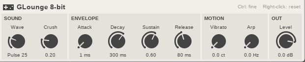
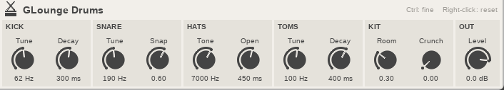
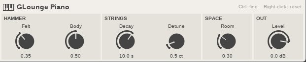

# GLounge

A small band of instruments for [REAPER](https://www.reaper.fm/), made for low-spec PCs. No samples to download: each sound is calculated live, in one small text file.

## The band

| Instrument | Status |
|---|---|
| **Bass** | Ready |
| **Electric guitar** | Ready |
| **8-bit** | Ready |
| **Drums** | Ready |
| **Piano** | Ready: closest to a small upright, not a concert grand |

## Install

| System | Download | Then |
|---|---|---|
| **Windows** | [GLounge-Windows.zip](https://github.com/absentlo/GLounge/releases/latest/download/GLounge-Windows.zip) | Unzip it and double-click `install.bat` |
| **Linux** | [GLounge-Linux.tar.gz](https://github.com/absentlo/GLounge/releases/latest/download/GLounge-Linux.tar.gz) | Extract it and run `./install.sh` |

Restart REAPER after installing.

On a portable REAPER, pass its folder to the installer, or copy the `.jsfx` and `.jsfx-inc` files into its `Effects` folder.

## Play

1. On a track, open the FX window, click **Add** and search for `GLounge`.
2. Arm the track and turn on monitoring.
3. Open **View > Virtual MIDI Keyboard** and play low notes. The bass's open E is E1, MIDI note 28.

## Controls

- **Drag up or down:** turn a knob.
- **Ctrl + drag:** turn it slowly.
- **Right-click:** reset a knob.
- **+ next to the preset list:** save a sound.

## Bass

| Knob | What it does |
|---|---|
| **Pluck** | How sharp the attack is. Velocity adds to it, so playing harder sounds brighter. |
| **Pick** | Fingers at 0, a pick at 1. |
| **Decay** | How long a held note rings. |
| **Tone** | Lower is darker. |
| **Drive** | From clean to a dirty amp. |
| **Level** | Output volume. |

The bass plays one note at a time, like a single string under your hand. Letting go of a key damps the string. Pitch bend reaches 2 semitones up or down.

## Guitar

| Knob | What it does |
|---|---|
| **Pluck** | How sharp the attack is. Velocity adds to it, so playing harder sounds brighter. |
| **Pick** | Fingers at 0, a pick at 1. |
| **Decay** | How long a held note rings. |
| **Position** | Where the pickup sits: warm at the neck (0), thin and bright at the bridge (1). |
| **Tone** | Lower is darker. |
| **Drive** | From clean to heavy fuzz. Chords get thick and messy at the top, as they do on a real amp. |
| **Level** | Output volume. |

It plays up to 6 notes at once, like six strings. A seventh note takes over the oldest. Letting go of a key damps its string, and pitch bend reaches 2 semitones up or down. For more space, add reverb and delay after it.

## 8-bit

A retro video game chip: four channels, simple waves and volume that moves in steps.

| Knob | What it does |
|---|---|
| **Wave** | Pulse 12 is thin and nasal, Pulse 25 is the classic lead, Pulse 50 is hollow, Triangle is the soft game bass, and Noise is for drums and effects. |
| **Crush** | From clean 8-bit to very crunchy. |
| **Attack, Decay, Sustain, Release** | The shape of each note. Set Sustain to 0 for short, plucky notes. |
| **Vibrato** | How far the pitch wobbles, in cents. |
| **Arp** | Plays held keys one after another at this speed, for those fast game-music chords. At 0, keys sound together, up to 4 at once. |
| **Level** | Output volume. |

With Noise, higher notes sound brighter, so low notes work for a snare or a rumble and high notes for a hi-hat. Pitch bend reaches 2 semitones up or down.

## Drums

A small acoustic-style kit with no samples: it simulates sticks striking skins and metal, in a small room. It follows the General MIDI drum map, so it works with most drum MIDI.

| Piece | MIDI notes |
|---|---|
| **Kick** | 35, 36 |
| **Snare** | 38, 40 |
| **Clap** | 39 |
| **Toms** | 41, 43, 45, 47, 48, 50 |
| **Closed hat** | 42, 44 |
| **Open hat** | 46 |
| **Crash** | 49, 52, 55, 57 |
| **Ride** | 51, 53, 59 |

| Knob | What it does |
|---|---|
| **Kick Tune, Decay** | How low it sits, and how long it rings. |
| **Snare Tune, Snap** | The drum's pitch, and how much of the snare wires you hear. |
| **Hats Tone, Open** | Higher is brighter. Open sets how long the open hat rings. |
| **Toms Tune, Decay** | The pitch of all the toms, and how long they ring. |
| **Room** | How much of the room you hear. At 0, the kit is dry and close. |
| **Crunch** | Dirt across the whole kit, off by default. |
| **Level** | Output volume. |

Playing harder is louder and brighter, and no two hits are identical. A closed hat cuts a ringing open hat, like the real pedal. For a bigger space, add reverb after it.

## Piano

An acoustic-style piano with no samples: it simulates a felt hammer striking pairs of stiff strings in a wooden case. It sounds closest to a small, intimate upright, not a bright concert grand.

| Knob | What it does |
|---|---|
| **Felt** | How soft the hammer is. Low is clear and present, high is warm and muted. |
| **Body** | The short wooden knock of the case on every hit. |
| **Decay** | How long a held note rings, measured around the middle of the keyboard. Low notes ring longer, as on a real piano. |
| **Detune** | How far apart each note's two strings are. A little adds life. A lot sounds like an old, out-of-tune upright. |
| **Room** | How much of the room you hear. At 0, it is dry and close. |
| **Level** | Output volume. |

It plays up to 8 notes at once, and the sustain pedal works (MIDI CC 64). Playing harder is louder and brighter, and low notes sit slightly to one side, as they do from the player's seat.

## Developers

Each instrument is one `.jsfx` file, and `glounge.jsfx-inc` holds the string and struck models, amp, room and UI they share. `python3 tests/smoke.py` renders them through REAPER and checks the audio. Pushing a tag like `v0.1.0` builds both downloads and publishes a release.

## License

[MIT](LICENSE)
